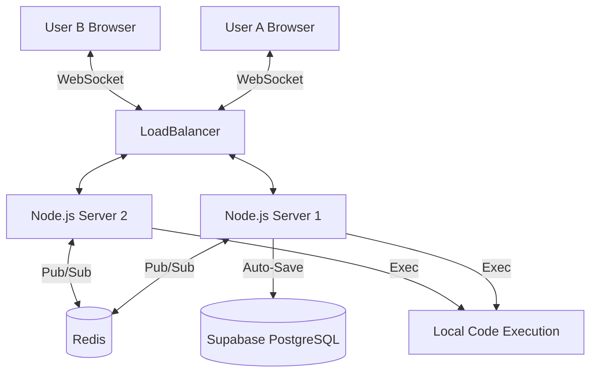

# 💻 CollabCode: Real-Time Collaborative Editor


CollabCode is a full-stack, distributed web application that allows multiple users to edit and execute code simultaneously in real-time. Designed as a high-performance clone of platforms like CoderPad, it features live remote cursors, isolated code execution, and horizontal scaling via Redis Pub/Sub.

## ✨ Features
- **Real-Time Collaboration:** Sub-millisecond latency syncing of code changes using WebSockets.
- **Visual Remote Cursors:** See exactly where other users are typing with color-coded, labeled cursors.
- **Multi-Language Execution Engine:** Compile and execute JavaScript, Python, C++, Java, Go, and Rust natively on the host server.
- **Horizontal Scalability:** Backend instances are synchronized using Redis Pub/Sub, allowing the WebSocket server to be scaled across multiple EC2 instances.
- **Authentication:** Secure user onboarding and identity management via Clerk.
- **Auto-Save:** Debounced automatic syncing to a Supabase PostgreSQL database.

## 🏗️ Architecture


## 🚀 Local Setup

1. **Clone the repository**
   ```bash
   git clone https://github.com/17102005kavya/Code-Collab.git
   cd Code-Collab
   ```

2. **Install Dependencies**
   Run the setup script to install all frontend and backend packages:
   ```bash
   setup.bat
   ```

3. **Environment Variables**
   - In `frontend/.env.local`, add your Clerk keys:
     ```env
     NEXT_PUBLIC_CLERK_PUBLISHABLE_KEY=your_key
     CLERK_SECRET_KEY=your_secret
     NEXT_PUBLIC_API_URL=http://localhost:4000
     ```
   - In `backend/.env`, add your Supabase keys:
     ```env
     SUPABASE_URL=your_url
     SUPABASE_KEY=your_key
     ```

4. **Start the Servers**
   Run the start script to launch both the Next.js frontend (Port 3000) and the Node.js backend (Port 4000):
   ```bash
   start.bat
   ```

## 🐳 Deployment (Docker & AWS)
The backend is fully dockerized and ready for cloud deployment. 
1. Provision an AWS EC2 Linux instance.
2. Clone the repository and run:
   ```bash
   sudo docker-compose -f docker-compose.prod.yml up -d --build
   ```
3. Deploy the Next.js `frontend` folder to Vercel, and set `NEXT_PUBLIC_API_URL` to your EC2 instance's IP address.
